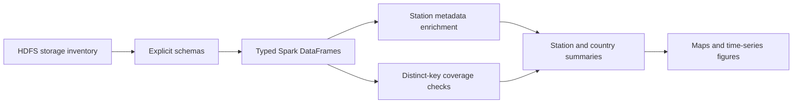
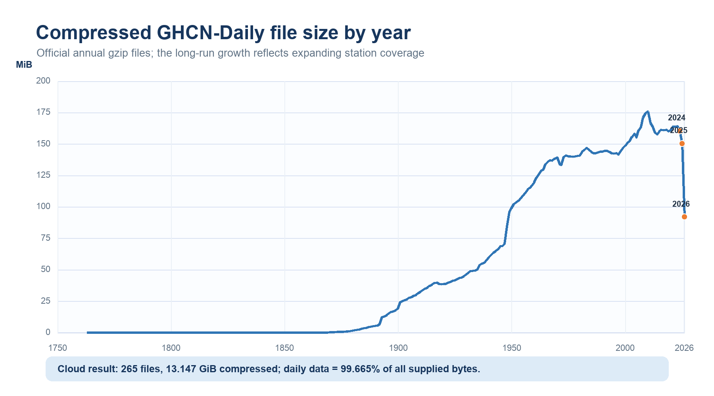
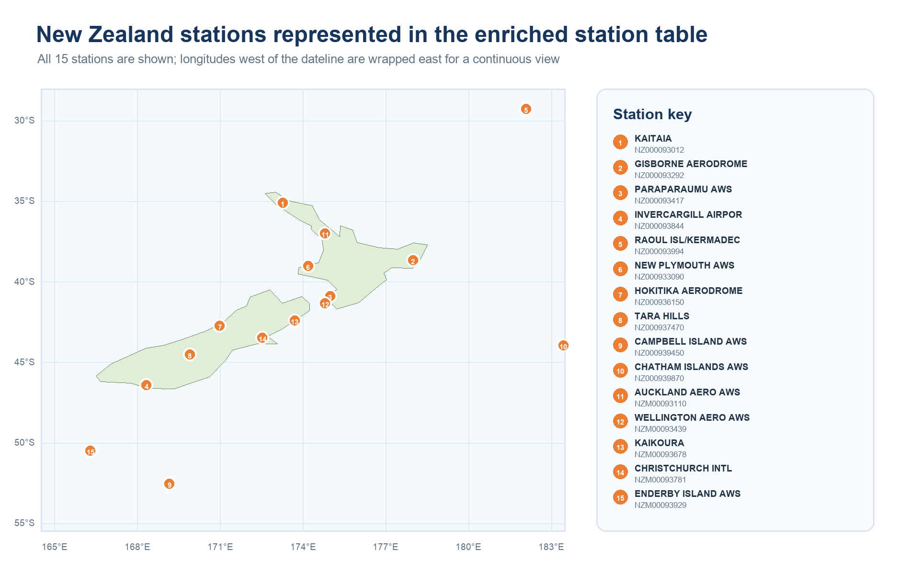
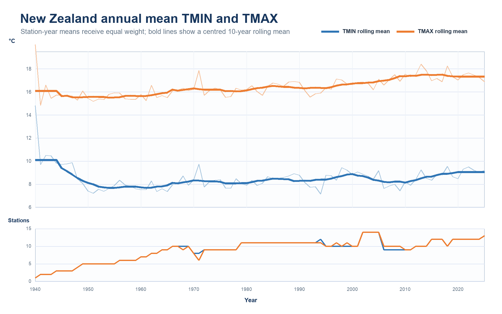
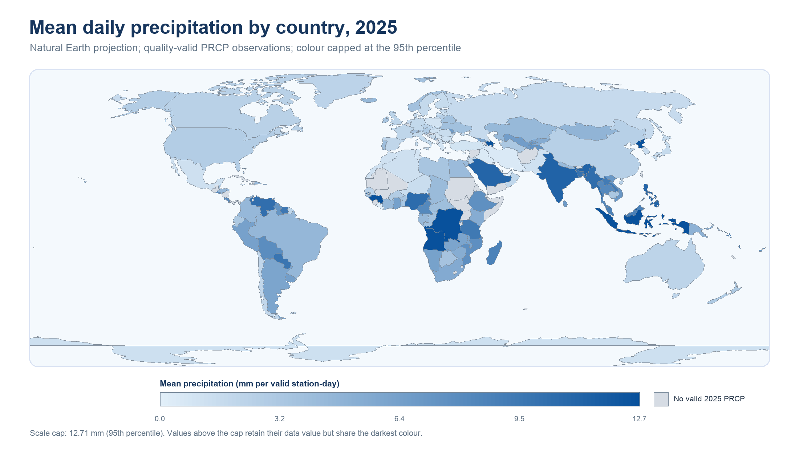

# GHCN-Daily Spark Climate Analytics

## Overview

This case study examines how a multi-billion-row climate archive can be inspected, validated, enriched, and summarised without attempting to hold the full observation table in driver memory.

The Global Historical Climatology Network Daily archive combines station-level daily observations from national and regional weather networks. The analysed cloud copy contained approximately **3.19 billion observation rows**, occupied **13.191 GiB in compressed form**, and included annual daily files plus station, country, state, and inventory metadata.

## Engineering workflow

1. Inspected HDFS-compatible file metadata before loading large files.
2. Parsed fixed-width station, country, state, and inventory records into typed Spark DataFrames.
3. Applied an explicit schema to annual daily observations.
4. Built a reusable station-level table from descriptive metadata and aggregated inventory history.
5. Validated identifiers in both directions using distinct station keys rather than joining metadata onto billions of observations.
6. Reduced daily records to bounded station-year or country-year summaries before plotting.

## Validated findings

| Measure | Result |
|---|---:|
| Daily observations | ~3.19 billion |
| Compressed supplied data | 13.191 GiB |
| Distinct observed station IDs | 132,438 |
| Station metadata IDs | 132,501 |
| Observed IDs absent from metadata | 0 |
| Metadata IDs absent from observations | 63 |
| New Zealand stations | 15 |
| Unordered New Zealand station pairs | 105 |
| Closest New Zealand pair | Paraparaumu–Wellington, ~50.529 km |

## Distributed-computing decisions

- **Metadata before data:** file listings established structure and scale without scanning observation contents.
- **Correct grain before joining:** ID-only coverage checks reduced a multi-billion-row comparison to 132,438 distinct observed keys.
- **Bidirectional validation:** left anti joins distinguished unknown observed IDs from registered stations with no archived observations.
- **Typed reusable output:** Parquet preserved schema and supported column-pruned downstream reads.
- **Bounded driver work:** Spark performed filtering and aggregation; only compact results were collected for visualisation.

## Visual evidence

### Growth in annual archive size

### New Zealand station locations

### National temperature summary

### Global precipitation summary

## Interpretation and limitations

- Station observations are not a spatially weighted national climate index.
- Station coverage changes over time and differs substantially between countries.
- Country-year precipitation means can be unstable when supported by few stations or observations.
- The 2026 archive was incomplete during the analysis and was not treated as a comparable full year.
- Exact counts can change with later archive snapshots.

## Skills demonstrated

PySpark · Spark SQL · fixed-width parsing · schema design · distributed joins · anti joins · Parquet · data-quality validation · geospatial distance · time-series aggregation · climate visualisation

## Reproducibility

Raw data and institution-specific storage paths are not included. See [docs/reproducibility.md](docs/reproducibility.md) for the public reproduction assumptions and environment guidance.

## Related portfolio

[Scalable Data Science with Apache Spark](https://github.com/sahil-mann/scalable-data-science-spark)
